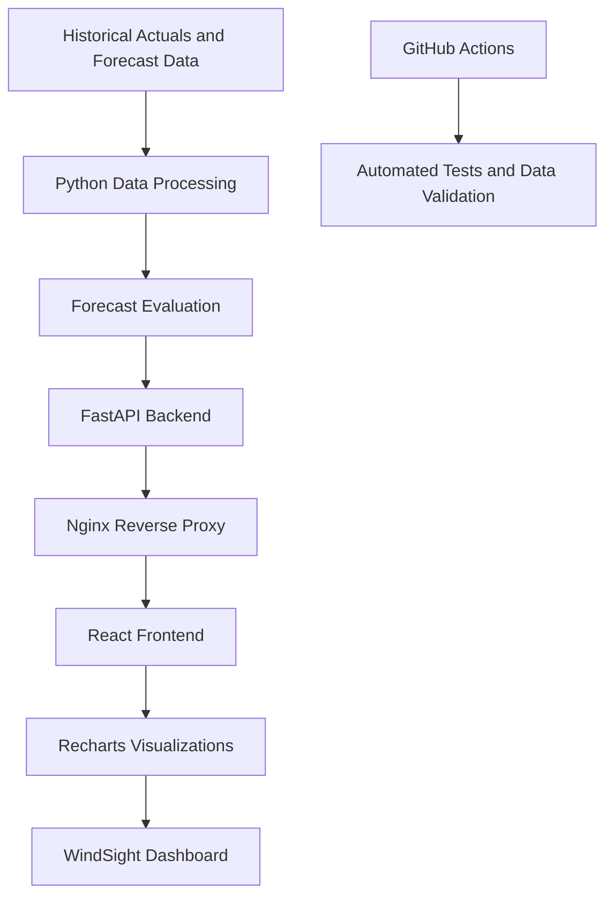

# WindSight — Wind Forecast Intelligence Dashboard

**An end-to-end renewable energy analytics platform for evaluating wind power forecasts, measuring prediction errors, and identifying forecast bias.**

[Live Demo](https://windsight-frontend-dytp.onrender.com) · [Backend API](https://windsight-api-99a5.onrender.com) · [API Documentation](https://windsight-api-99a5.onrender.com/docs)

## Overview

WindSight compares day-ahead wind generation forecasts against historical actual generation to help users understand forecast accuracy and identify potential operational risks.

The dashboard presents forecast performance through key statistical metrics, hourly generation comparisons, daily error trends, and forecast bias analysis.

**Dataset:** January 2026 historical data  
**Evaluation coverage:** 744 hourly records

## Key Results

| Metric | Day-ahead forecast |
|---|---:|
| Mean Absolute Error (MAE) | 2,017.92 |
| Root Mean Squared Error (RMSE) | 2,477.04 |
| Forecast Bias | +1,806.23 |
| Mean Absolute Percentage Error (MAPE) | 19.68% |

**Interpretation:** The positive forecast bias indicates systematic overforecasting over the evaluated period. This matters because forecast errors can affect renewable energy planning and procurement decisions.

*These metrics describe the evaluated January 2026 dataset and should not be interpreted as guarantees of future performance.*

## Features

- **Forecast accuracy:** Evaluate day-ahead forecasts using MAE, RMSE, and MAPE.
- **Forecast bias:** Identify systematic overforecasting or underforecasting.
- **Hourly comparison:** Compare actual wind generation with forecast generation.
- **Daily performance:** Examine how forecast errors change over time.
- **Risk analysis:** Investigate days with larger forecast errors.
- **Historical analysis:** Explore the January 2026 evaluation period.
- **Automated validation:** Run tests and dataset quality checks through GitHub Actions.

## Architecture



### Request Flow

1. Historical actual and forecast data are processed in Python.
2. The backend calculates or serves forecast evaluation results through FastAPI endpoints.
3. The React frontend requests analytics from the backend.
4. Nginx forwards frontend API requests to the deployed backend.
5. Recharts renders the resulting metrics and time-series data.

## Technology Stack

| Layer | Technologies |
|---|---|
| Frontend | React, Vite, JavaScript |
| Visualization | Recharts |
| Backend | Python, FastAPI |
| Data analysis | Pandas, NumPy |
| Web server / proxy | Nginx |
| Testing | Pytest |
| Data validation | Python validation scripts |
| CI/CD | GitHub Actions |
| Deployment | Render |
| Version control | Git, GitHub |

## Testing and Data Quality

The project includes automated backend tests and dataset validation.

Previously verified locally:

- 25 automated tests passed.
- Dataset validation passed.
- Actual generation data contained 1,488 half-hour intervals.
- The evaluation dataset covered 744 hourly records.
- Actual and forecast coverage matched across the evaluated 744 hours.

GitHub Actions is configured to run automated tests and dataset validation when changes are pushed to `main` or submitted through a pull request.

## Running Locally

### 1. Clone the repository

```bash
git clone https://github.com/Veerkumar45/wind-forecast-intelligence.git
cd wind-forecast-intelligence
```

### 2. Set up the Python environment

```bash
python -m venv .venv
```

Activate the environment on Windows:

```cmd
.venv\Scripts\activate
```

Install backend dependencies:

```bash
pip install -r backend/requirements.txt
```

### 3. Start the backend

```bash
cd backend
uvicorn main:app --reload
```

The API should be available at `http://127.0.0.1:8000`, with interactive documentation at `http://127.0.0.1:8000/docs`.

### 4. Start the frontend

Open a second terminal:

```bash
cd frontend
npm install
npm run dev
```

Open the local frontend URL printed by Vite, normally `http://localhost:5173`.

**Note:** The local Vite proxy and production Nginx proxy are configured separately. For local development, the backend must be running on port 8000.

## Project Structure

```text
wind-forecast-intelligence/
├── backend/
│   ├── data/
│   ├── main.py
│   ├── requirements.txt
│   └── validate_data.py
├── frontend/
│   ├── src/
│   ├── nginx.conf
│   ├── Dockerfile
│   └── package.json
├── tests/
├── screenshots/
├── .github/
│   └── workflows/
└── README.md
```

## Screenshots

The repository includes dashboard screenshots covering:

- Dashboard overview
- Forecast accuracy
- Forecast bias
- Hourly actual-versus-forecast comparison
- Worst forecast days

## Future Improvements

- Add support for additional evaluation periods.
- Compare multiple forecasting models.
- Introduce confidence intervals and uncertainty analysis.
- Improve monitoring and API error reporting.
- Add automated performance and deployment smoke tests.

## Author

**Veerkumar Kuagji**

Computer Science graduate interested in software engineering, machine learning, renewable energy analytics, and building practical software systems.

---

**Explore the live dashboard:**  
https://windsight-frontend-dytp.onrender.com
