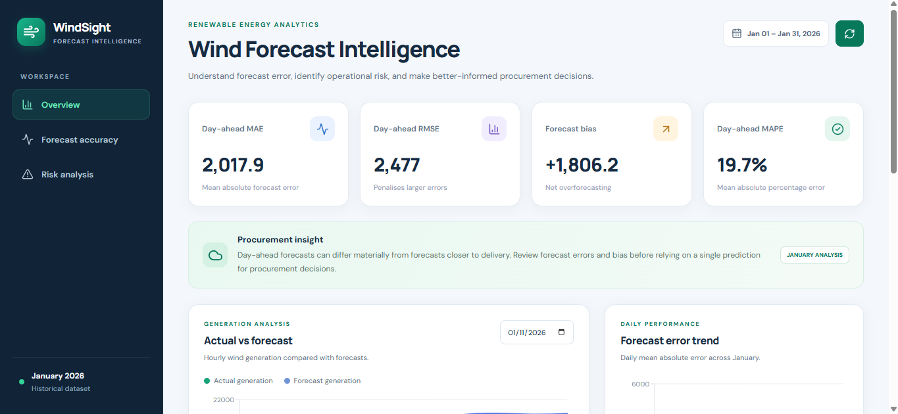
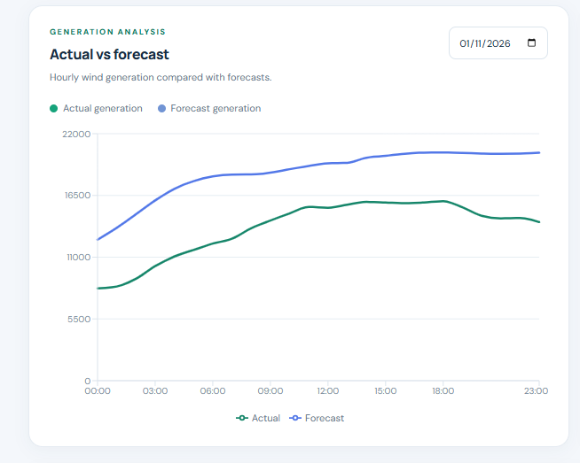
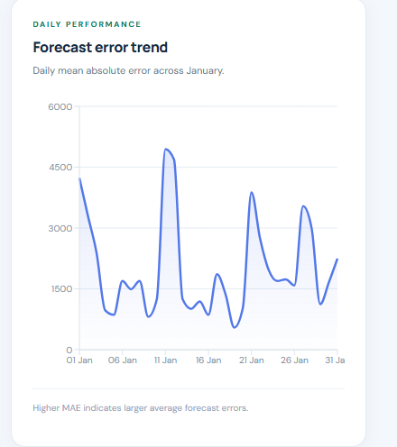
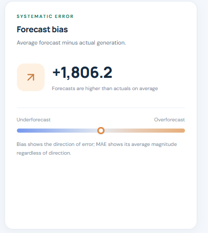
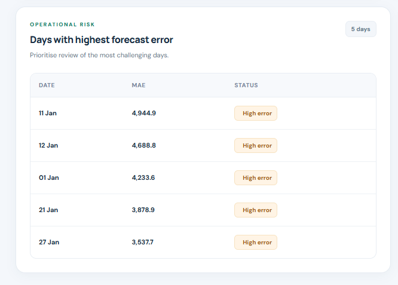

[](https://github.com/Veerkumar45/wind-forecast-intelligence/actions/workflows/tests.yml)
# WindSight — Wind Forecast Intelligence Dashboard

A full-stack data analytics dashboard for evaluating wind power forecast accuracy against actual electricity generation data. WindSight provides forecast performance metrics, hourly comparisons, daily error analysis, and forecast bias insights using UK wind data from January 2026.

## Overview

Wind power forecasts are important for electricity system planning. Understanding the difference between predicted and actual generation helps analysts evaluate forecast performance and identify periods of larger errors.

WindSight processes historical wind generation and forecast data and presents the results through an interactive dashboard.

## Features

- **Forecast accuracy KPIs:** Mean Absolute Error (MAE), Root Mean Squared Error (RMSE), forecast bias, and Mean Absolute Percentage Error (MAPE).
- **Hourly comparison:** Visual comparison of actual wind generation against forecasts.
- **Daily accuracy analysis:** Examine daily MAE across January 2026.
- **Worst forecast days:** Identify days with the largest forecast errors.
- **Forecast bias analysis:** Understand whether forecasts tend to overestimate or underestimate actual generation.
- **REST API:** Access processed analytics through FastAPI endpoints.
- **Docker support:** Run the frontend and backend using Docker Compose.

## Technology Stack

| Component | Technologies |
|---|---|
| Frontend | React, Vite, Recharts |
| Backend | Python, FastAPI |
| Data processing | Pandas, NumPy |
| Data format | JSON, CSV |
| Deployment | Docker, Docker Compose |

## Architecture

```text
Historical Wind Data (JSON / CSV)
              |
              v
     Python Data Processing
        Pandas / NumPy
              |
              v
        FastAPI Backend
              |
       REST API Endpoints
              |
              v
       React Dashboard
       Vite + Recharts
              |
              v
      Interactive Analytics
```

## Dataset

The project uses UK electricity system wind data associated with Elexon's Balancing Mechanism Reporting Service (BMRS).

The included dataset covers January 1–31, 2026.

| Dataset | Description |
|---|---|
| `wind_actuals_january_2026.json` | 1,488 half-hourly actual wind generation records |
| `wind_forecasts_january_2026.json` | 18,080 wind forecast records |
| `daily_forecast_accuracy_january_2026.csv` | 744 hourly records of daily forecast accuracy analysis |

The hourly evaluation contains 744 delivery hours for January 2026.

**Data source:** Elexon BMRS. Verify the applicable dataset documentation and usage terms before redistributing the raw data.

## Forecast Accuracy Results

The following results are calculated from the project's January 2026 evaluation.

### Day-ahead forecast

| Metric | Result |
|---|---:|
| Mean Absolute Error (MAE) | 2,017.92 |
| Root Mean Squared Error (RMSE) | 2,477.04 |
| Forecast Bias | +1,806.23 |
| Mean Absolute Percentage Error (MAPE) | 19.68% |
| Evaluated delivery hours | 744 |

### Baseline comparison

| Metric | Day-ahead forecast | Baseline forecast |
|---|---:|---:|
| MAE | 2,017.92 | 1,799.54 |
| RMSE | 2,477.04 | 2,287.10 |
| MAPE | 19.68% | 16.46% |
| Bias | +1,806.23 | +1,592.87 |

The evaluated day-ahead forecasts have a higher MAE and RMSE than the project's baseline. Both forecast sets show positive bias, indicating overforecasting under the project's bias convention.

**Evaluation assumption:** Day-ahead forecasts are selected using the latest forecast published by 12:00 UTC on the previous calendar day. This is a project-defined evaluation rule, not a claim about the official market deadline.

The baseline uses the latest forecast published at or before the delivery-hour start. Results depend on these selection rules and the available data.

## API Endpoints

The FastAPI backend provides the following endpoints.

| Method | Endpoint | Purpose |
|---|---|---|
| GET | `/` | Root endpoint |
| GET | `/api/health` | Health and data availability check |
| GET | `/api/summary` | Summary metrics and KPIs |
| GET | `/api/daily-accuracy` | Daily forecast accuracy |
| GET | `/api/hourly-comparison` | Hourly actual-versus-forecast data |
| GET | `/api/worst-days` | Days with the largest forecast errors |
| GET | `/api/forecast-bias` | Forecast bias analysis |

The hourly comparison endpoint supports date filters:

```text
/api/hourly-comparison?start_date=2026-01-01&end_date=2026-01-31
```

The worst-days endpoint supports a result limit:

```text
/api/worst-days?limit=5
```

## Run Locally

### Prerequisites

- Python installed
- Node.js and npm installed
- Git installed

### 1. Clone the repository

```bash
git clone 
cd wind-forecast-intelligence
```

Replace the placeholder with your actual repository URL.

### 2. Start the backend

Open a terminal in the project directory:

```bash
cd backend
python -m venv .venv
```

Activate the virtual environment.

**Windows PowerShell:**

```powershell
.\.venv\Scripts\Activate.ps1
```

Install the dependencies:

```bash
pip install -r requirements.txt
```

Start the FastAPI application:

```bash
uvicorn app.main:app --reload
```

The backend should be available at:

- API: `http://127.0.0.1:8000`
- Interactive API documentation: `http://127.0.0.1:8000/docs`
- Health check: `http://127.0.0.1:8000/api/health`

Run the command from the `backend` directory.

### 3. Start the frontend

Open a second terminal:

```bash
cd frontend
npm install
npm run dev
```

Open the local URL printed by Vite, typically:

```text
http://localhost:5173
```

Keep the backend running while using the dashboard.

## Run with Docker

Docker Compose provides a convenient way to start the frontend and backend together.

From the project root, run:

```bash
docker compose up --build -d
```

Check the running containers:

```bash
docker compose ps
```

View service logs:

```bash
docker compose logs
```

Open the dashboard:

```text
http://localhost:8080
```

Check the backend:

```text
http://127.0.0.1:8000/api/health
```

Stop the services:

```bash
docker compose down
```

These commands assume Docker Desktop is installed and running and that the Compose configuration exposes the ports described above.

## Project Structure

```text
wind-forecast-intelligence/
├── backend/
│   ├── app/
│   │   └── main.py
│   ├── data/
│   │   ├── wind_actuals_january_2026.json
│   │   ├── wind_forecasts_january_2026.json
│   │   └── daily_forecast_accuracy_january_2026.csv
│   └── requirements.txt
├── frontend/
│   ├── src/
│   ├── package.json
│   └── vite.config.js
├── docker-compose.yml
└── README.md
```

This is a representative overview; additional files may exist in the repository.

## Key Learnings

- Building REST APIs with FastAPI.
- Processing and analyzing time-series data using Pandas and NumPy.
- Comparing forecasts with actual observations.
- Evaluating prediction errors using MAE, RMSE, MAPE, and bias.
- Visualizing analytical results in a React dashboard.
- Connecting a frontend to a backend API.
- Containerizing an application using Docker Compose.

## Limitations

- The current evaluation covers January 2026 only.
- Forecast accuracy results depend on the forecast-selection rules and data availability.
- The reported metrics describe forecast errors; they do not directly establish financial savings or operational cost reductions.
- Additional months and out-of-sample testing would be needed to assess performance across different seasons.

## Future Improvements

- Add support for additional months and historical periods.
- Introduce configurable forecast lead-time filters.
- Add date-range and forecast-type filters to the dashboard.
- Include automated data validation and data-quality reporting.
- Add unit and integration tests for API endpoints and metric calculations.
- Implement automated data ingestion and scheduled evaluation.
- Add continuous integration and deployment checks.

## Dashboard Preview

### 1. Dashboard Overview
View the key forecast performance indicators, including MAE, RMSE, forecast bias, and MAPE.



### 2. Hourly Actual vs. Forecast
Compare actual wind generation against forecast generation throughout the day.



### 3. Daily Forecast Accuracy
Identify changes in daily mean absolute forecast error throughout January 2026.



### 4. Forecast Bias Analysis
Understand the direction and magnitude of systematic forecast error.



### 5. Operational Risk Analysis
Identify the five days with the highest mean absolute forecast error.


